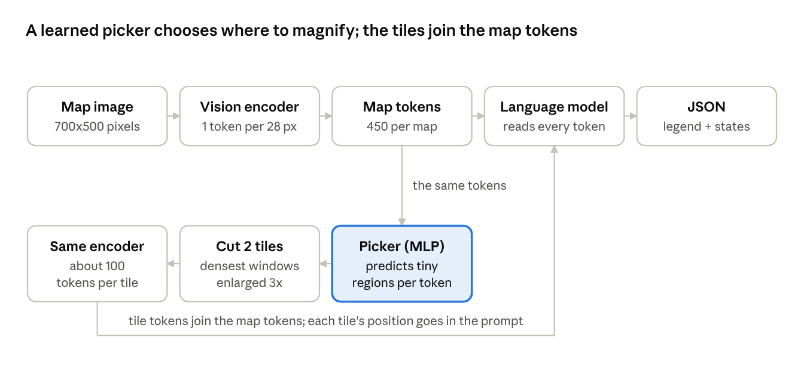

# Derenderer Methodology

Sep 30, 2026

## Summary

The derenderer now reads Rhode Island correctly on 94% of maps instead of 47%, and gets every state on the map exactly right on 90% of maps instead of 33%.

The derenderer is the first stage of our pipeline: it reads a choropleth map of the US and writes out its data as JSON (title, legend, and one value per state). After fine-tuning, it read 48 of the 50 states almost perfectly. The two it kept missing, Rhode Island and Delaware, are smaller than the model's unit of vision, a 28x28-pixel square, so their colour was blurred into their neighbours before the language part of the model ever saw it.

The fix: magnify only the parts of the map where regions that small sit, and hand those magnified tiles to the model as extra images. A small learned network, reading the model's own image features, decides where to magnify. Along the way we tested six other ideas, including the model-level multi-scale approaches suggested to us; this document explains each one, why we tried it, and how it fared.

## The task

The derenderer only reads the map; all arithmetic happens later, in code. That split is the point of the whole pipeline:

1. **Derenderer (this work):** a vision-language model turns the map image into a table of values.
2. **Code layer:** ordinary code computes the spatial statistics (clusters, hot spots, trends) on that table, using a graph of which states border which.
3. **Narrator:** a language model turns those computed facts into a written summary.

End-to-end vision models get numbers and spatial claims wrong, so we keep the model to perception, the one thing only a model can do.

### What the model writes

```json
{"title": "Unemployment Rate by State, 2023", "legend_title": "%", "legend_type": "discrete",
 "data_type": "percentage", "ranges": ["2-3", "3-4", "4-5", "5+"],
 "values": {"AK": 2, "AL": 0, "AR": 1, "...": "...", "WY": null}}
```

- **Discrete legends** (colour boxes with ranges): each state gets the index of its range, 0 = lowest, and `ranges` lists the labels exactly as printed.
- **Continuous legends** (a colour bar): each state gets a number read off the bar, rounded to about 100 steps of the bar's span.
- **No data** is `null`.
- **State codes are kept** even though the order is fixed. Without them, one skipped state would shift every later value, the model would have to count list positions, and the format would not carry over to other countries.
- **Continuous values are numbers, not positions on the bar.** Our main dataset does not record where the bar's tick labels sit, so positions could not be turned back into values.

## Data

We train on real maps from MapQA and add synthetic maps we generate ourselves, because every MapQA map looks the same.

| Dataset | Maps (train / dev / test) | Why we use it |
| --- | --- | --- |
| MapQA-S | 12,470 / 4,155 / 4,157 | Real labelled US choropleths at scale; the standard benchmark. 76% have discrete legends. |
| Synthetic US | 9,938 / ~1,000 / ~1,000 | Style variety MapQA lacks: other palettes, fonts, legend layouts, units, JPEG noise. |
| Synthetic India | 9,845 / 980 / 981 | A second geography, to check whether a method only works on the US. |

**MapQA-S.** Every map carries its underlying values, so we converted those into the JSON targets above. The split is by map, so no test map is ever seen in training. Its weakness is sameness: one projection, one layout, one style of colour bar. A model could learn that style rather than the task.

**Synthetic US maps.** Drawn from real state outlines (geoBoundaries) with randomised topics, units, palettes, legend types and positions, fonts, backgrounds, state labels and JPEG compression. Values follow random, clustered or gradient patterns, with some states missing. Every map is checked before it is kept: each state's colour is read back from the rendered pixels and must match its label, and no text may be cut off the image.

**Synthetic India maps.** The same generator on India's 36 states and union territories, with official borders and Indian topics. Four union territories (Lakshadweep, Chandigarh, Puducherry, Dadra and Nagar Haveli and Daman and Diu) are drawn but left out of the answer: at these image sizes they are 0.3 to 20 pixels, too small for anything to read. That leaves 32 regions; the smallest, Delhi, is about half the size of Rhode Island. So far India is used only for checks, not as a training target.

## Model and training

The main model is Qwen2.5-VL-3B, fine-tuned with LoRA on a single free Kaggle T4 GPU.

**How the model sees.** Qwen2.5-VL has two parts: a vision encoder and a language model. The encoder cuts the image into 14-pixel patches and merges each 2x2 group into one token, so **one token stands for a 28x28-pixel square** of the map. A 700x500 MapQA map becomes about 450 tokens. The language model reads those tokens plus our instructions and writes the JSON. The 28-pixel token turns out to be the centre of this whole story.

**Why this model.** It is strong at reading documents and charts, its weights are open, and at 3B parameters it fits a free 16 GB GPU. Untrained, the larger 7B version read continuous maps reasonably in our early zero-shot tests but failed on discrete legends (valid output only 35% of the time), so fine-tuning was needed.

**How we fine-tune.** LoRA adds small trainable matrices to the frozen model: 42M trainable weights out of 3.8B (1.1%), on the language model and the vision encoder's feed-forward layers. We train in fp16 with AdamW at a learning rate of 2e-4, warmup then cosine decay, and an effective batch of 16 maps. Every run is given a time budget, and the learning-rate schedule is fitted to it.

**One shared starting point.** The first run trained for 8 hours on MapQA plus synthetic US maps (8,640 maps seen, about 39% of one pass through the data). Every later experiment continues from that same 8-hour model, so they differ only in what we changed.

**Small-model baseline.** DePlot (282M parameters), a model built for turning charts into tables. After 1 hour it had learned the JSON format (titles and legend ranges 90-94% right) but wrote the same value for every state: it learned the format, not the reading. That is not yet a fair comparison with 8 hours of Qwen, so it is parked.

**Compute.** All runs used free Kaggle T4 GPUs, launched from a laptop and collected through the Kaggle API, across two accounts.

## How results are measured

Every run is scored on the same 400 MapQA test maps (302 discrete, 98 continuous), drawn once at random and never trained on. A few early runs used the first 120 of those, and are marked where they appear.

**Discrete maps**, where each state gets a range:

- **Valid JSON:** the output parses and has every key.
- **Title, legend title, legend type, data type:** each copied correctly.
- **Legend ranges correct:** the list of ranges matches the legend exactly.
- **State accuracy:** the share of the 50 states given the right range, averaged over maps.
- **Per state** (e.g. Rhode Island): the share of maps on which that one state is right. This is where the small-state problem shows.
- **Whole map exact:** the entire answer is identical to the truth: every state, every legend field. The strictest number, and the one a user of the pipeline feels most.

**Continuous maps**, where each state gets a number:

- **Error:** how far off each state's number is, as a share of that map's value range, capped at 100%. A map running from 40 to 60 where the model says 51 for a true 50 has a 5% error on that state. We report the mean over states and maps, and also the median over maps, because one badly wrong map can drag a mean.
- **Within 5%:** the share of states whose error is 5% of the range or less.

**Comparing two runs.** Because every run sees the same maps, we compare them map by map instead of only comparing averages. For each pair we count maps the first run gets right and the second gets wrong ("fixed"), and the reverse ("broke"). If a change did nothing, fixes and breaks should be roughly even; an exact binomial test on those two counts gives the p-value (how likely a split that lopsided is by chance).

**The control.** Every tile method can also be scored with the tiles taken away, on the same trained weights. That separates "the tiles helped" from "the extra training helped".

## First results, and the problem they exposed

After 8 hours the model read maps well overall but failed on two tiny states, and those two failures are most of why only a third of maps came out exactly right.

| Baseline, 8 hours | Result |
| --- | --- |
| Valid JSON, titles, legend fields | 100% |
| Legend ranges correct | 99.0% |
| State accuracy | 97.8% (99.4% without Rhode Island and Delaware) |
| Whole map exact | 33.1% |
| Continuous error, mean | 4.1% of the value range |
| Continuous within 5% | 85.0% |
| Synthetic test maps | 97.3% states, 3.5% continuous error |

**The failure was concentrated in two places.** Rhode Island was right on 47% of discrete maps and Delaware on 74%; New Hampshire came next at 92%, and every other state was at 96% or better. On continuous maps, Rhode Island's error was 25% of the range, against 2-3% for a typical state.

**The cause is resolution, not legend reading.** Rhode Island covers about 9x13 pixels, less than half of one 28x28-pixel token. Its token also holds bits of Connecticut, Massachusetts and the ocean, and the encoder blends them into one vector before the language model sees anything. The same states fail on both legend types, which rules out a problem with reading ranges or colour bars. And because "whole map exact" needs all 50 states right, one missed tiny state spoils the whole answer.

This set the question for everything after: **how do we give the model enough pixels of its smallest regions?**

## The search for a fix, step by step

Nine steps, each chosen because of what the previous one showed. Rhode Island (RI) accuracy on discrete maps is the running score; the baseline is 47%.

### 1. Train longer

- **Why:** the simplest explanation for a weak spot is too little training.
- **Result:** RI did not move. Seven more hours on more data later confirmed it: RI 44% without magnification.
- **Lesson:** the state's colour is already lost inside the token. No amount of training can recover information that is not in the input.

### 2. A hand-made crop of the north-east

- **Why:** if the problem is too few pixels, give the model more pixels. We cut out the north-east corner, enlarged it 3x, and passed it as a second image.
- **Result:** RI rose to 60%, but continuous maps got worse. A follow-up found the cause: in that run we had also trained the vision encoder's attention layers. With those left untouched, continuous error was the best yet (2.4%) and the crop still helped RI.
- **Lesson:** magnification works, and the pretrained vision encoder should be left alone. But the crop box was measured by hand for US maps; for another country we would need a new box and a new training run.

### 3. Model-level multi-scale (S2)

- **Why:** our professor suggested doing multi-scale inside the model, as Swin, Mask2Former and FPN do, rather than in the data. Replacing the vision backbone with one of those was beyond our compute and would throw away the pretrained encoder, so we tested the closest cheap version, S2 ("Scaling on Scales"). It runs the same encoder on the whole map at 2x, averages the fine features back onto the normal grid, and joins them to the normal features, so the model gets no extra tokens.
- **Result:** RI 42%, slightly below baseline.
- **Lesson:** averaging four fine tokens back into one re-blurs the small state, the same problem one step removed. The joining layer also needed 8.4M new weights, which about 80 training updates could not teach.

### 4. Adaptive tiles, chosen from the picture

- **Why:** keep the crop's magnification but let the image decide where to magnify, so nothing is tied to US geography.
- **How:** find region borders inside the map (the legend is excluded), slide a window over the map, take the 2 windows with the most border pixels, enlarge them 3x and pass them as extra images.
- **Result:** RI 75% (first 120 test maps). With the tiles taken away from the same trained model, RI fell to 44%: the tiles fixed RI on 31 maps and broke it on 1.

### 5. Count the real failure, and say where each tile came from

- **Why:** border density was a stand-in. What actually fails is a region smaller than one token, so count those directly.
- **How:** remove the borders, label each remaining patch, and count patches between 40 and 784 pixels (one token). Specks under 40 pixels are rendering noise where borders meet. The chosen tiles are the windows with the most such regions. Each tile's position is also written into the prompt, e.g. "view 2: x 0.64-0.78, y 0.31-0.50".
- **Result:** RI 82% on the first 120 maps; 80.8% on all 400, with the whole map exact on 73.8%.

### 6. Fusion: fold the tiles into the model's own tokens

- **Why:** tiles as extra images cost about 200 extra tokens per map. Fusion cuts each tile to line up with the model's token grid, encodes it at 3x, and adds its detail into the 9 map tokens it covers, so the model still gets 450 tokens and the tile's position is built in. It is the model-level version of step 5.
- **Result:** RI 44%. The new fusion layer had barely moved from where it started, at exactly zero, and that start also blocked its first half from learning. A fair retry, with a 10x learning rate on the new layer and a small non-zero start, did learn, but RI stayed at 47% (baseline) and whole-map accuracy fell slightly.
- **Lesson:** new weights that learn only through the JSON answer, in 100-200 updates, did not learn anything the model could use.

### 7. Tile settings

- **Why:** choose settings for the final model.
- **Result:** 1, 2 or 3 tiles at 3x gave RI 80.5%, 80.8% and 78.8%, no real difference. 2 tiles at 2x gave 59.9%, much worse.
- **Lesson:** the magnification matters; the number of tiles does not, since the US small states sit in one cluster. Tiles should go only where the map is dense, at 3x.

### 8. More data and training, with tiles

- **Why:** the 8-hour model had seen only 39% of the training data once.
- **How:** 7 more hours on MapQA plus the synthetic US maps plus 1,000 India maps, with step 5's tiles.
- **Result:** RI 83.8%, whole map exact 79.8% (against 73.8% for 1.5 hours: 24 maps fixed, 6 broken). The same model with tiles removed: RI 44%, no better than baseline.
- **Lesson:** more data helps, but only together with tiles.

### 9. A learned picker: the model decides where to zoom

- **Why:** so far a hand-written rule, running outside the model, chose the tiles. We wanted the model itself to choose.
- **How:** a small network (2048 -> 256 -> 1) reads each of the 450 image tokens the model has already computed and predicts how many tiny regions sit in that token's square. The windows with the highest predicted counts become the tiles. It learns from the rule's counts on 1,800 maps, in minutes, with the rest of the model frozen.
- **A mistake on the way:** the first version predicted only yes/no per token. Eight small north-eastern states packed into a few tokens then looked no busier than a lake shore, and RI dropped to 52%. We switched to counts, and checked on CPU with perfect labels that the new tiles cover as many small regions as the rule's (78.3% vs 78.6%) before spending GPU time.
- **Result:** on the same trained model, RI 94.4% with the picker vs 83.8% with the rule (fixed on 38 maps, broke 6), and whole map exact 89.7% vs 79.8%.

## The final method

The model looks at the whole map once, decides for itself where the tiny regions are, and looks again at just those places, magnified.



The top row is the normal model; the bottom row is what we added.

1. The map goes through the vision encoder as usual: about 450 tokens, one per 28x28-pixel square.
2. **The picker**, a small learned network (the only new part), reads those same 450 tokens and predicts how many regions smaller than one token sit in each square.
3. The two windows with the highest predicted counts are cut from the original map and enlarged 3x.
4. Each enlarged tile goes through the same vision encoder, giving about 100 more tokens per tile.
5. The language model reads the map tokens, the tile tokens, and a prompt that says where each tile came from ("view 2: x 0.64-0.78, y 0.31-0.50"), and writes the JSON.

No hand-written image code runs at test time. The only fixed operation is the cut-and-enlarge itself, the same kind of fixed resampling LLaVA's image tiling uses.

## Final comparison

On the same 400 test maps, the learned picker reads states best on both legend types.

| Method | Training after the 8-hour model | Rhode Island | Delaware | State accuracy | Whole map exact | Continuous error (median) | Continuous within 5% |
| --- | --- | --- | --- | --- | --- | --- | --- |
| Baseline, no tiles | none | 47.0% | 74.2% | 97.8% | 33.1% | 3.0% | 85.0% |
| Fusion (fair retry) | 1.5 h | 47.0% | 76.8% | 97.3% | 26.5% | 3.3% | 81.6% |
| Rule tiles | 1.5 h | 80.8% | 94.4% | 99.0% | 73.8% | 2.4% | 88.4% |
| Rule tiles | 7 h, more data | 83.8% | 95.7% | 99.1% | 79.8% | 2.1% | 90.0% |
| **Learned picker tiles** | **7 h, more data** | **94.4%** | **96.4%** | **99.3%** | **89.7%** | **2.0%** | **90.4%** |

One continuous map, with a legend in millions, pulls up the mean error of the 7-hour models: the model wrote 3.62 where the answer was 3,620,000. That is why the table shows the median; on means, the 1.5-hour rule model is lowest (2.6% vs 3.2-3.3%).

### One change at a time

Each row compares two runs on the same maps that differ in one thing.

| Change | Rhode Island: fixed / broke | Whole map exact: fixed / broke | p (whole map) |
| --- | --- | --- | --- |
| Learned picker instead of rule, same weights | 38 / 6 | 41 / 11 | 0.00004 |
| Tiles on vs off, same weights | 125 / 5 | 146 / 2 | < 10^-40 |
| More data and training, with tiles | 17 / 8 | 24 / 6 | 0.001 |
| More data and training, without tiles | 13 / 22 | 14 / 17 | 0.72 |
| Fusion on vs off, same weights | 6 / 3 | 3 / 25 | 0.00003 (worse) |

### Did the picker just memorise the US north-east?

It could have: on every MapQA map the small states sit in the same corner. To test this without retraining, we showed the trained picker the test maps mirrored and flipped, which moves that cluster to another corner, and 200 India maps it had never seen.

| Maps shown | Rule's tiles hold | Picker's tiles hold | Picker's first tile in the top-right |
| --- | --- | --- | --- |
| US, as drawn | 79% of small regions | 68% | 100% |
| US, mirrored left-right | 76% | 68% | 0.5% |
| US, flipped top-bottom | 71% | 61% | 2% |
| US, rotated 180 | 71% | 63% | 0% |
| India | 64% | 53% | 99% (India's small states are in its north-east too) |

When the cluster moves, the picker's tiles move with it, and its gap to the rule stays about the same everywhere, India included. So it follows the small regions, not a remembered location. It holds fewer small regions than the rule yet scores better end to end. The likely reason is that it lands on Rhode Island more consistently, but we have not proven that.

## Model level or data level?

The choice of *where* to look closer is now made inside the model and learned. The closer look itself is still a fixed zoom.

The question we were asked: crops and scaled images simulate multi-scale learning at the data level; can it be done at the model level instead? Multi-scale has two separate parts, and they came out differently.

| Method | Who decides where to look closer | How the closer look enters the model | Result |
| --- | --- | --- | --- |
| Hand-made crop | a person, once, for the US | extra image | helps, but only for the US |
| S2 | nobody: the whole map at 2x | learned layer inside the model | failed |
| Rule tiles | hand-written image rule | extra image | works |
| Fusion | hand-written image rule | learned layer inside the model | failed twice |
| **Learned picker** | **a learned network inside the model** | extra image | **works best** |

**Deciding where to look is model-level, and it works.** The picker is a trained part of the model that reads the model's own image features. At test time the model alone decides where the small regions are, and it beats the hand-written rule it learned from.

**Combining the closer look inside the network did not work in our budget.** Both attempts (S2 and fusion) needed millions of new weights that could learn only through the final JSON answer, and 100-200 training updates were not enough. The fully model-level designs suggested (Swin, Mask2Former, FPN) go further: they replace or retrain the vision backbone, which needs pretraining at a scale we do not have and would discard what the pretrained encoder already knows.

**Why this is not only data augmentation.** Augmentation shows crops during training and then drops them. Here the tiles are part of how the model runs on every test map, as the tiling in LLaVA-style models is. The one fixed operation is the resample that enlarges the tile, and the model's own encoder does the looking.

**The general lesson from our runs:** anything that reused the pretrained parts worked. New parts trained only through the final answer did not learn in our budget. The picker is new but learns from direct labels on every token, and it trained in minutes.

## Limits and next steps

The method is proven on US maps; generality and full-scale training are what remain.

### What we have not shown yet

- **Other countries, end to end.** India exposed two US-shaped assumptions in the hand-written rule: its 40-pixel speck threshold throws away Delhi, and picking the 2 densest windows always goes to India's north-east cluster, never to the isolated Delhi or Goa. The model saw only about 270 India maps in training and gets 71% of Indian regions right; that is an observation, not a result.
- **Full-scale training.** Our best model has seen roughly 55-60% of the training data once.
- **The full test set.** All numbers use one 400-map sample. The one-change-at-a-time comparisons are solid, but the absolute percentages will move a little on all 4,157 test maps.
- **Why the picker beats its teacher.** It holds fewer small regions than the rule, yet scores better. We have a likely explanation, not a proof.
- **Units in millions.** On a map labelled in millions the model can drop the scale (3.62 instead of 3,620,000).
- **A fair small-model baseline.** DePlot has had 1 hour of training against Qwen's 8.

### Next

1. **Full training run** on the lab GPU: learned picker with tiles, MapQA plus synthetic maps, 2-3 passes over the data, scored on the full test set.
2. **Pretrain the picker on random-polygon maps.** These are generated maps where small cells appear anywhere, with exact labels from the generator, so the picker learns smallness itself, not US layouts. We would also try a small convolutional network over the token grid, since "a dense cluster" is a neighbourhood pattern that a per-token network sees only indirectly.
3. **Tiles only where needed.** Put a tile wherever the map is dense and nowhere else, instead of always 2. The sweep showed the count matters little and the magnification a lot.
4. **India as a training target**, once the picker finds Delhi and Goa.
5. **Stages 2 and 3:** the spatial-statistics code layer and the narrator, fed by this derenderer.
